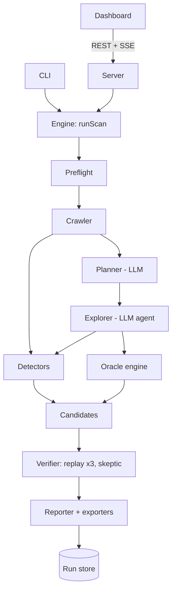

# Witness — architecture

One TypeScript engine does the work; the server, dashboard and CLI are thin shells around it. Only the Explorer is an agent. Everything that decides "is this really a bug?" is deterministic.

## 1. Repository layout (pnpm workspaces)

```
witness/
├─ CLAUDE.md                     # instructions for Claude Code
├─ .env.example
├─ package.json                  # root scripts: dev, bench, scan, eval, test, lint
├─ pnpm-workspace.yaml
├─ docs/                         # SPEC, ARCHITECTURE, AI_AGENT_SPEC, SECURITY, EVALUATION, DEMO_RUNBOOK, ROADMAP, DEVLOG
├─ packages/
│  └─ engine/                    # @witness/engine — all scanning logic, no web framework
│     └─ src/
│        ├─ index.ts             # runScan(config, sink): Promise<RunResult>
│        ├─ config/              # zod config schema, budget presets, env loading
│        ├─ browser/             # context factory + safety policy (origin guard, write blocking, permissions)
│        ├─ record/              # evidence recorder, evidence IDs, screenshot compression, redaction
│        ├─ crawl/               # BFS crawler, state normalisation + dedupe
│        ├─ detectors/           # one file per DET-* detector + registry
│        ├─ llm/                 # gateway (providers, schemas, retries, cache, cost, call log), prompts/
│        ├─ plan/                # Planner: app model, journeys, expectations
│        ├─ explore/             # Explorer loop, executor, tools, locator recording, edge inputs
│        ├─ oracle/              # check language (zod) + evaluators + number parsing
│        ├─ verify/              # replayer, evidence/grounding validation, skeptic, tiering
│        ├─ report/              # grouping, fingerprints, severity, verdict, writer, exporters (html/md/json)
│        ├─ export/              # Playwright test generator
│        ├─ store/               # RunStore interface + JSON implementation; suppressions
│        └─ events.ts            # typed event union for progress streaming
├─ apps/
│  ├─ server/                    # @witness/server — Express 5, REST + SSE, serves built web app
│  ├─ web/                       # @witness/web — React + Vite + Tailwind dashboard
│  └─ cli/                       # @witness/cli — `witness scan`
├─ bench/
│  ├─ BENCH_SPEC.md
│  ├─ bugs.yaml                  # ground truth (frozen after Phase 0)
│  └─ app/                       # @witness/bench — Harbour Clean
├─ eval/                         # matrix runner, scorer, labels.json, results/
└─ runs/                         # run artifacts (git-ignored)
```

## 2. Components and data flow



Phases run in order; each emits events. Detectors run on every recorded state (crawl and agent). The verifier consumes **recorded evidence and steps only** — never the agent's reasoning text.

## 3. Core types (engine public API)

Use zod for every type that crosses a boundary (LLM output, API input, files on disk); derive TS types with `z.infer`.

```ts
type ScanMode = "staging" | "production";
type BudgetPreset = "quick" | "standard" | "deep";
type Pipeline = "deterministic" | "ai-no-verify" | "full" | "full-no-skeptic";

interface ScanConfig {
  url: string;
  mode: ScanMode;
  budget: BudgetPreset;
  credentials?: { username: string; passwordRef: string }; // passwordRef = key in in-memory SecretVault
  hint?: string;
  pipeline: Pipeline;               // default "full"
  llmCache: "off" | "rw" | "replay";
  viewport: { width: number; height: number };     // default 1280x800
  mobileViewport: { width: number; height: number }; // 375x667 for DET-OVERFLOW
  approvedJourneyIds?: string[];     // set after plan review
  seed?: number;                     // for eval repeatability where possible
}

type EvidenceKind =
  | "screenshot" | "aria_snapshot" | "network" | "console" | "page_error"
  | "timing" | "axe" | "check_result" | "dom_probe";

interface Evidence {
  id: string;                 // "ev_" + short id; the ONLY IDs an LLM may cite
  kind: EvidenceKind;
  stateId?: string;
  stepId?: string;
  createdAt: string;
  path?: string;              // artifact file (screenshots, snapshots)
  data: unknown;              // kind-specific, zod-validated
}

interface PageState {
  id: string;                 // "st_..."
  url: string;
  routePattern: string;       // /services/:id
  structureHash: string;      // hash of aria snapshot roles/names skeleton
  title: string;
  evidenceIds: string[];
  discoveredBy: "crawl" | "agent";
}

type Locator =
  | { by: "role"; role: string; name?: string; exact?: boolean }
  | { by: "label"; text: string; exact?: boolean }
  | { by: "placeholder"; text: string }
  | { by: "testId"; id: string }
  | { by: "text"; text: string; exact?: boolean }
  | { by: "css"; selector: string };        // last resort
// optional modifiers on any locator: { within?: Locator; nth?: number }

type Action =
  | { type: "goto"; path: string }
  | { type: "click"; target: Locator; clickCount?: 2 } // 2 = double-click (edge inputs)
  | { type: "fill"; target: Locator; value: string } // value may be "{{secret:password}}"
  | { type: "select"; target: Locator; option: string }
  | { type: "press"; key: string }
  | { type: "reload" }
  | { type: "scroll"; direction: "down" | "up" }
  | { type: "wait"; ms: number }
  | { type: "check"; check: Check; expectationId?: string }; // asserts/captures, re-evaluated on replay (DEVLOG D30)

interface Step {
  id: string;                  // "sp_..."
  journeyId: string;
  index: number;
  kind: "happy" | "edge" | "preamble";   // preamble = login
  action: Action;              // with a STABLE locator, verified unique at record time
  description: string;         // human-readable, generated deterministically from action
  beforeEvidenceIds: string[];
  afterEvidenceIds: string[];
  urlBefore: string;
  urlAfter: string;
  ok: boolean;                 // executor succeeded
  error?: string;
}

interface Expectation {
  id: string;                  // "ex_..."
  journeyId: string;
  statement: string;           // plain language: "Total equals subtotal plus 15% GST"
  check: Check;                // see AI_AGENT_SPEC.md §6
  grounding:
    | { kind: "ui_text"; quote: string; verified: boolean; evidenceId?: string }
    | { kind: "convention"; rationale: string }
    | { kind: "requirement"; quote: string; verified: boolean }; // ADDENDUM A5 (hook added in P2)
  impact: "money" | "data-loss" | "blocks-completion" | "wrong-info" | "cosmetic";
  category?: "functional" | "state" | "validation" | "ux";
  when?: string;               // plain-language moment to evaluate it (for the Explorer)
  origin?: "plan" | "agent" | "edge";
}

interface Journey {
  id: string;                  // "jr_..."
  title: string;
  goal: string;
  priority: "core" | "secondary";
  startRoute: string;
  suggestedSteps: string[];
  expectations: Expectation[];
  status: "proposed" | "approved" | "skipped" | "running" | "completed" | "incomplete";
  incompleteReason?: string;
}

type FindingCategory =
  | "functional" | "crash" | "validation" | "state" | "broken-resource"
  | "accessibility" | "performance" | "security" | "responsive" | "ux";

interface Candidate {
  id: string;                  // "cd_..."
  source:
    | { kind: "detector"; id: string }                 // DET-*
    | { kind: "check"; id: string; expectationId: string } // id = check type
    | { kind: "judgement"; expectationId?: string; confidence: number }
    | { kind: "ux-review" };
  category: FindingCategory;
  route: string;
  journeyId?: string;
  stepIds: string[];           // steps needed to reproduce (may be empty for static detectors)
  evidenceIds: string[];
  signature: Signature;        // what "the same failure" means on replay
  summary: string;
}

type Signature =
  | { kind: "check_failed"; expectationId: string }
  | { kind: "http"; method: string; pathPattern: string; statusClass: "4xx" | "5xx" }
  | { kind: "page_error"; messagePrefix: string }
  | { kind: "detector"; detectorId: string; key: string }   // e.g. axe rule + target selector
  | { kind: "judgement"; expectationId: string };

type Tier = "confirmed" | "likely" | "needs_review" | "discarded";
type ImprovementTier = "evidence_based" | "suggestion";

interface Finding {
  id: string;                  // "fd_..."
  fingerprint: string;         // stable across runs (suppression, diff)
  kind: "bug" | "improvement";
  tier: Tier | ImprovementTier;
  tierReason: string;          // "Reproduced 3/3; grounded in on-screen text 'Total (incl. 15% GST)'"
  severity: "critical" | "high" | "medium" | "low";
  category: FindingCategory;
  source: Candidate["source"];
  route: string;
  title: string;               // LLM-written, fact-checked
  impact: string;              // one plain-language sentence
  whyFlagged: string;          // which layer and rule
  steps: string[];             // deterministic from Step.description
  expected: string;
  actual: string;
  likelyCause?: { text: string; isHypothesis: true };
  evidenceIds: string[];
  instances: { route: string; evidenceIds: string[] }[]; // grouped duplicates
  replay: { attempts: number; reproduced: number; notes?: string };
  skeptic?: { verdict: "bug_likely" | "unclear" | "benign_likely"; reason: string };
  signals: {                   // structured fields the eval scorer matches on
    request?: { method: string; path: string; status: number; durationMs?: number };
    errorMessage?: string;
    axeRuleId?: string;
  };
  testFile?: string;           // path of exported Playwright test
  suppressed?: { reason: string; at: string };
}

interface RunResult {
  runId: string;
  config: Omit<ScanConfig, "credentials">;
  startedAt: string; finishedAt: string;
  verdict: { level: "ready" | "caveats" | "not_ready"; reason: string };
  notTested: string[];
  findings: Finding[];         // includes discarded, flagged by tier
  journeys: Journey[];
  states: PageState[];
  stats: {
    pages: number; steps: number; llmCalls: number;
    inputTokens: number; outputTokens: number; costUsd: number;
    candidates: number; discarded: number; durationMs: number;
    capsHit: string[];
  };
  aiStagesSkipped?: string;    // NFR-3
}
```

## 4. Run store (JSON on disk)

```
runs/<runId>/
  run.json            # RunResult (without large evidence payloads)
  events.ndjson       # every emitted event, append-only
  evidence.ndjson     # Evidence records (data inline when small)
  llm-calls.ndjson    # role, model, promptHash, tokens, costUsd, latencyMs, valid, error
  artifacts/          # screenshots (jpg), aria snapshots (yaml), axe results (json)
  tests/              # exported Playwright specs
  report.html, report.md
data/suppressions.json   # [{ origin, fingerprint, reason, createdAt }]
.witness-cache/v2/       # LLM response cache (git-ignored); keys ignore run-generated IDs (DEVLOG D86)
```

`RunStore` interface: `createRun`, `appendEvent`, `putEvidence`, `getEvidence`, `hasEvidence`, `putArtifact`, `saveResult`, `getResult`, `listRuns`, `getSuppressions`, `addSuppression`. Only the JSON implementation is built.

## 5. Browser layer and safety policy

`createContext(config, purpose)` returns a Playwright `BrowserContext` with:

- Fresh, non-persistent context per journey / replay; `acceptDownloads: false`; permissions denied; `reducedMotion: "reduce"`; service workers blocked.
- **Origin guard:** `page.route("**/*")` handler — top-level navigations (`request.isNavigationRequest() && frame === page.mainFrame()`) to another origin are aborted and logged. Sub-resources from other origins are allowed (apps need CDNs) except in `strict` mode.
- **Production write block:** in `production` mode, same-origin requests with method POST/PUT/PATCH/DELETE are aborted **unless** they match the login request recorded during preflight. Aborted requests are tagged so DET-REQFAIL ignores them.
- Dialogs (`alert/confirm/prompt`) auto-dismissed and logged as evidence.
- Non-http(s) schemes blocked.
- Rate limit: executor waits ≥ 300 ms between actions.
- Password inputs masked in screenshots (`mask: [page.locator('input[type=password]')]`).

This is enforced in code, not prompts, and covered by tests (`SECURITY.md` §4).

## 6. Recording, replay and test export

**Recording.** The Explorer refers to elements by the `ref` values in the AI-mode aria snapshot (`page.ariaSnapshot({ mode: "ai" })` — check the installed Playwright version's API and adjust). Before acting, the executor converts the ref into a **stable locator**, preferring in order: role+accessible name → label → placeholder → test id → text → css. It verifies the locator resolves to exactly one element (adding `within`/`nth` if needed), acts through that locator, and stores it in the step. If the ref can't be resolved to a unique stable locator, the step fails with a clear message to the agent.

**Waiting.** After each action: wait for `domcontentloaded` if navigation occurred, then for network quiet (no in-flight same-origin requests for 500 ms, capped at 3 s), then capture evidence.

**Replay.** `replay(candidate)` opens a fresh context, runs the preamble (login) steps, then the candidate's steps using stored locators and values (secrets resolved from the vault), then re-evaluates the signature: re-run the check (same captures), or look for the same HTTP method + path pattern + status class, or the same page-error message prefix, or re-run the detector. Three attempts → `reproduced` count. No LLM calls are allowed during replay (the gateway throws if called with a `replay` context flag).

**Test export.** Deterministic translation of steps + signature into a Playwright spec:

```ts
import { test, expect } from "@playwright/test";
import { parseAmount } from "./witness-helpers";   // emitted alongside
const BASE_URL = process.env.WITNESS_BASE_URL ?? "http://localhost:5180";

test("Quote total includes GST once [fd_8k2p]", async ({ page }) => {
  await page.goto(`${BASE_URL}/quote`);
  await page.getByRole("combobox", { name: "Service" }).selectOption("Regular home clean");
  await page.getByRole("spinbutton", { name: "Hours" }).fill("3");
  await page.getByRole("button", { name: "Calculate" }).click();
  // Expectation grounded in on-screen text: "Total (incl. 15% GST)"
  const subtotal = parseAmount(await page.getByTestId("quote-subtotal").innerText());
  const total = parseAmount(await page.getByTestId("quote-total").innerText());
  expect(total).toBeCloseTo(subtotal * 1.15, 2);
});
```

Universal signatures export as: 5xx → `const res = await page.waitForResponse(r => /\/api\/bookings$/.test(r.url()) && r.request().method() === "POST"); expect(res.status()).toBeLessThan(500);` · page error → collect `pageerror` events and `expect(errors).toEqual([])` · broken image → `expect(await img.evaluate(i => i.naturalWidth)).toBeGreaterThan(0)` · overflow → evaluate scrollWidth at 375 px.

## 7. Server API (Express)

| Method & path | Purpose |
| --- | --- |
| `POST /api/scans` | Body: ScanConfig input (+ plaintext password, immediately moved to the in-memory vault; optional `pipeline` for evaluation runs). Staging mode on a non-local host needs `confirmStagingOnNonLocal: true` (FR-1). Returns `{ runId }` |
| `GET /api/scans` | `{ live, runs }`: the running scan (if any, with its time and spend caps) and every run's summary |
| `GET /api/scans/:id` | RunResult (409 while that scan is still running) |
| `GET /api/scans/:id/events` | SSE: a `hello` event says whether the run is live; then past events, then live ones; `end` when finished. A finished run's stream is its record from `events.ndjson` |
| `POST /api/scans/:id/plan` | `{ approvedJourneyIds }` (plan review) |
| `POST /api/scans/:id/cancel` | Cancel: the run is saved as cancelled, with no verdict |
| `GET /api/scans/:id/artifacts/:file` | Screenshot / snapshot by file name (`ev_….jpg` or `.yaml`; path-traversal safe) |
| `GET /api/scans/:id/findings/:fid/screenshot` | The finding's first screenshot |
| `GET /api/scans/:id/export?format=html\|md\|json` | Download report |
| `GET /api/scans/:id/findings/:fid/test` | Download exported spec |
| `POST /api/suppressions`, `GET /api/suppressions?origin=` | "Not a bug": `{ origin, fingerprint, reason }` → `data/suppressions.json` (never `eval/labels.json`) |
| `GET /api/eval/latest[?path=]` | The newest results folder's first `summary.json`, and the list to switch between |

One scan at a time (409 if busy). Bind to `127.0.0.1` only; requests addressed to any host name other than localhost get 403 (DNS rebinding), and so do writes from another site's `Origin`. No CORS headers (DEVLOG D80).

## 8. Event protocol (SSE `data:` JSON)

```ts
type WitnessEvent =
  | { t: "phase"; phase: "preflight" | "map" | "plan" | "explore" | "verify" | "report" | "done"; at: string }
  | { t: "page"; state: Pick<PageState, "id" | "url" | "routePattern" | "title">; thumb?: string }
  | { t: "detector"; candidateId: string; detectorId: string; summary: string }
  | { t: "plan"; journeys: Journey[]; autoApproveInMs: number }   // > 0: waiting for review (D79)
  | { t: "journey"; journeyId: string; status: Journey["status"] }
  | { t: "step"; step: Pick<Step, "id" | "journeyId" | "index" | "description" | "ok" | "kind">; thumb?: string }
  | { t: "candidate"; candidate: Pick<Candidate, "id" | "category" | "summary" | "route"> & { title?: string } }
  | { t: "verify"; candidateId: string; stage: "evidence" | "replay" | "skeptic" | "tier"; detail: string }
  | { t: "tier"; candidateIds: string[]; tier: Finding["tier"]; reason: string }   // verification's decision
  | { t: "finding"; finding: Pick<Finding, "id" | "title" | "tier" | "severity" | "kind" | "tierReason" | "candidateIds" | "category"> }
  | { t: "cost"; llmCalls: number; costUsd: number }   // after every LLM call
  | { t: "log"; level: "info" | "warn" | "error"; message: string }
  | { t: "done"; verdict: RunResult["verdict"] }
  | { t: "error"; message: string };
```

`thumb` is a screenshot's file name in the run's `artifacts/` folder. Plain-language labels for phases, tiers, severities and verdicts live in one browser-safe module, `report/view.ts` (`@witness/engine/view`), shared by the HTML and Markdown exports and the dashboard.

## 9. Dashboard (React + Vite + Tailwind)

Pages: **New scan** (form + mode warning; requirements textarea and file upload; offline cache-replay option), **Live run** (phase stepper in plain words; "Now:" line; plan review with 10 s auto-approve countdown; pages with thumbnails; action log with thumbnails; candidate → tier transitions with the reason; time and spend meters; cancel), **Report** (verdict banner, then Requirements coverage, then Security, then what wasn't tested and what the time cap cut, then Bugs / Needs review / Improvements / Discarded tabs, finding cards, exports), **History** (every run labelled with its date and time; only the running scan says Live), **Evaluation** (plain SVG bars, no chart library: recall and precision per pipeline, per-category recall, per-bug table, clean-build false positives, cost/time). Routing is a 40-line history router (no library). Design: calm, legible, plain-language labels; severity and tier shown with text + colour (never colour alone); readiness verdict readable from across a room.

## 10. Key decisions (ADR-lite; extend in DEVLOG.md)

| Decision | Chosen | Alternatives | Why |
| --- | --- | --- | --- |
| Input | Running app URL | Repo, upload | Stack-agnostic; tests real UX; no untrusted code execution |
| Page representation for the LLM | AI-mode aria snapshot | Screenshots, raw HTML | 20–50× smaller than screenshots; semantic; gives refs |
| Oracle | Check language + deterministic evaluators | LLM verdicts | Precision; replayable; exportable to tests |
| Agentic scope | Explorer only | Multi-agent | Only exploration needs a loop |
| Storage | JSON files behind an interface | SQLite/Postgres | Single user; no native builds on Windows |
| LLM SDK | Vercel AI SDK + zod | LangChain, raw SDKs | Structured outputs + tools + provider switch with little abstraction |
